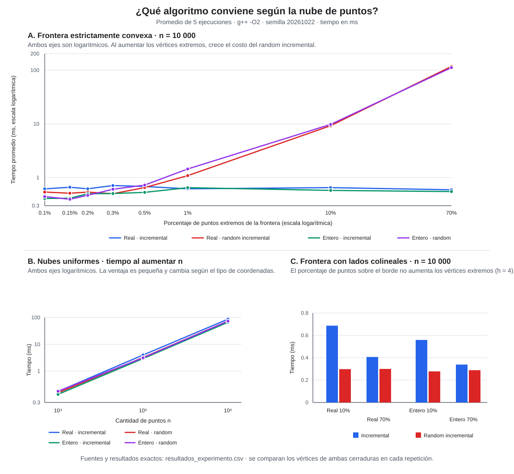

# Informe experimental: algoritmos de cerradura convexa

## Problema

Para una nube de puntos, escoger entre `IncrementalAlgorithm` (ordenar y construir la cerradura) y `RandomIncrementalAlgorithm` (insertar en orden aleatorio) puede cambiar el tiempo de cálculo según el tamaño y la cantidad de puntos que realmente queden en la frontera. El experimento busca caracterizar esa elección, no asumir que un método es siempre superior.

## Hipótesis en forma de pregunta

1. **Nube aleatoria:** ¿Para nubes uniformes sin un porcentaje de puntos en frontera fijo, cuál de los dos algoritmos resuelve más rápido el problema de hallar la cerradura para `n = 10^4, 10^5, 10^6, 10^7`?
2. **Umbral de puntos extremos:** ¿Hasta qué porcentaje de puntos en una frontera estrictamente convexa conviene usar el método random incremental?
3. **Colinealidad y tipo de coordenada:** ¿Cambia la elección o el costo relativo cuando los puntos de frontera son colineales en vez de estrictamente convexos, y cuando las coordenadas son enteras en vez de reales?

## Estrategias de generación de puntos

Los generadores implementan `PointCloudGenerator<T>`. Ambos reciben `n` y un `std::mt19937`, y producen exactamente `n` puntos:

- `UniformPointCloudGenerator<T>` genera puntos uniformes. Para `double`, usa coordenadas continuas en `[-1,1]`; para `long long`, usa coordenadas enteras en `[-1 000 000,1 000 000]`.
- `BoundaryInteriorPointCloudGenerator<T>` recibe un porcentaje. Genera esa cantidad de puntos en la frontera y pone los restantes en el interior. Permite dos formas:
  - `StrictlyConvex`: círculo para reales y parábola entera estrictamente convexa para enteros.
  - `CollinearSides`: distribuye puntos sobre los lados de un cuadrado, los puntos intermedios de cada lado pertenecen a la frontera pero no son vértices extremos.

El número de puntos en la frontera se redondea al entero más cercano. En la parábola entera, los puntos interiores se generan entre la curva y la cuerda superior. En el cuadrado, se generan dentro del cuadrado.

## Protocolo experimental

- Compilador: `g++ 15.2.0`, C++17, opciones `-O2 -Wall -Wextra`.
- Procesador: AMD Ryzen 7 9700X.
- Memoria RAM: 32 GB DDR5.
- Tamaños: `n = 10 000`, `100 000`, `1 000 000` y `10 000 000`.
- Cinco repeticiones por escenario, con semilla maestra `20261022`; las nubes se generan antes de cronometrar. Cada algoritmo recibe la misma nube y se usa una semilla aleatoria reproducible por ejecución del algoritmo aleatorizado.
- Se comparan coordenadas `double` y `long long`, y se verifica en cada repetición que ambos algoritmos devuelvan el mismo conjunto de vértices. Si difieren, el experimento falla.
- En `n = 10 000` se probaron fronteras estrictamente convexas de `0.1 %`, `0.15 %`, `0.2 %`, `0.3 %`, `0.5 %`, `1 %`, `10 %` y `70 %`; además, fronteras con lados colineales de `10 %` y `70 %`.
- En `n = 100 000`, se probaron fronteras estrictamente convexas de `0.1 %` y `1 %`; en `n = 1 000 000`, `0.01 %`; y en `n = 10 000 000`, `0.001 %`. Los dos últimos porcentajes mantienen una frontera de 100 vértices para comparar el crecimiento con el tamaño de la nube. Se reduce la cantidad de porcentajes al aumentar `n` porque el costo del algoritmo random incremental crece con el número de vértices de la frontera.

Los tiempos reportados son promedios en milisegundos. Los resultados completos por escenario están en [resultados_experimento.csv](./resultados_experimento.csv).

## Gráfico comparativo

En el panel A se usa escala logarítmica para que se distingan tanto los tiempos bajos como el aumento pronunciado del random incremental cuando casi todos los puntos son extremos. El panel B compara el crecimiento en nubes uniformes hasta `n = 10^7`; el panel C muestra por qué un alto porcentaje de puntos sobre el borde no implica necesariamente muchos vértices cuando hay colinealidad.

## Resultados: nubes uniformes

| Coordenadas | n | Vértices de la cerradura | Incremental (ms) | Random incremental (ms) | Más rápido en esta corrida |
|---|---:|---:|---:|---:|---|
| Reales | 10 000 | 21 | 0.683 | 0.613 | Random |
| Enteras | 10 000 | 26 | 0.515 | 0.554 | Incremental |
| Reales | 100 000 | 31 | 7.833 | 7.146 | Random |
| Enteras | 100 000 | 29 | 6.326 | 6.780 | Incremental |
| Reales | 1 000 000 | 30 | 87.145 | 82.194 | Random |
| Enteras | 1 000 000 | 37 | 71.405 | 79.630 | Incremental |
| Reales | 10 000 000 | 46 | 983.351 | 979.069 | Random |
| Enteras | 10 000 000 | 41 | 805.749 | 956.153 | Incremental |

En nubes uniformes reales, el random incremental resultó entre aproximadamente 0.4 % y 10 % más rápido; en las enteras, el incremental fue entre aproximadamente 7 % y 16 % más rápido. A `n = 10^7`, la diferencia en reales fue inferior al 1 %, mientras que en enteros el incremental fue cerca de 16 % más rápido. Las diferencias dependen de la muestra, el equipo y la precisión/tipo numérico, por lo que no prueban una ventaja general.

## Resultados: frontera estrictamente convexa

### n = 10 000

| Porcentaje | Vértices | Incremental real (ms) | Random real (ms) | Incremental entero (ms) | Random entero (ms) |
|---:|---:|---:|---:|---:|---:|
| 0.1 % | 10 | 0.637 | 0.559 | 0.335 | 0.336 |
| 0.15 % | 15 | 0.659 | 0.471 | 0.392 | 0.391 |
| 0.2 % | 20 | 0.646 | 0.501 | 0.468 | 0.578 |
| 0.3 % | 30 | 0.650 | 0.484 | 0.507 | 0.591 |
| 0.5 % | 50 | 0.624 | 0.687 | 0.573 | 0.725 |
| 1 % | 100 | 0.698 | 1.096 | 0.542 | 1.279 |
| 10 % | 1 000 | 0.744 | 8.921 | 0.597 | 9.444 |
| 70 % | 7 000 | 0.584 | 118.020 | 0.561 | 107.537 |

### Tamaños mayores

| n | Porcentaje | Vértices | Incremental real (ms) | Random real (ms) | Incremental entero (ms) | Random entero (ms) |
|---:|---:|---:|---:|---:|---:|---:|
| 100 000 | 0.1 % | 100 | 7.577 | 10.445 | 6.170 | 12.578 |
| 100 000 | 1 % | 1 000 | 7.982 | 79.217 | 6.280 | 80.083 |
| 1 000 000 | 0.01 % | 100 | 88.183 | 108.219 | 64.444 | 155.185 |
| 10 000 000 | 0.001 % | 100 | 978.849 | 1 220.170 | 611.039 | 1 695.970 |

### Frontera con lados colineales, n = 10 000

| Coordenadas | Porcentaje de puntos en la frontera | Vértices extremos | Incremental (ms) | Random incremental (ms) |
|---|---:|---:|---:|---:|
| Reales | 10 % | 4 | 0.684 | 0.355 |
| Reales | 70 % | 4 | 0.416 | 0.294 |
| Enteras | 10 % | 4 | 0.491 | 0.282 |
| Enteras | 70 % | 4 | 0.336 | 0.323 |

Los puntos intermedios colineales de cada lado pertenecen al borde geométrico, pero los algoritmos devuelven solo los vértices extremos; por eso la cerradura de estos casos tiene cuatro vértices aunque aumente el porcentaje de muestras en la frontera.

## Análisis de las hipótesis

1. **Nube aleatoria:** no hay ganador independiente del tipo. El random incremental fue más rápido en las cuatro nubes reales, aunque a `n = 10^7` la diferencia fue inferior al 1 %; el incremental fue más rápido en las cuatro nubes enteras. Las diferencias no justifican escoger el algoritmo solo por saber que la nube es “aleatoria”.
2. **Umbral de puntos extremos:** aparece un límite, pero no un porcentaje universal. Para `n = 10 000`, el random incremental fue competitivo hasta cerca de `0.3 %` en reales y `0.15 %` en enteros; desde `0.5 %` y `0.2 %`, respectivamente, fue más lento en esta corrida. Al crecer `n`, fue más lento incluso con 100 vértices: tanto con `0.1 %` en `n = 100 000` como con `0.01 %` en `n = 1 000 000` y `0.001 %` en `n = 10 000 000`. El factor determinante es el número absoluto de vértices de la cerradura junto con `n`, no solo el porcentaje.
3. **Colinealidad y tipo numérico:** con 10 % o 70 % de puntos sobre lados colineales, la frontera solo tenía cuatro vértices y el random incremental fue más rápido en esta corrida. Con frontera estrictamente convexa, el número de vértices creció con el porcentaje y el random incremental se degradó rápidamente.

## Conclusión y limitaciones

En distribuciones uniformes que producen una cerradura pequeña, ambos métodos tienen tiempos comparables y las mediciones no dan un ganador robusto; a `n = 10^7` ambos tardaron alrededor de un segundo. Si se espera que una parte apreciable de la entrada forme una frontera estrictamente convexa, conviene el algoritmo incremental por ordenamiento: su tiempo se mantuvo cercano a `O(n log n)`, mientras que el random incremental revisa la frontera en cada inserción y puede acercarse a `O(nh)` (`h` es el número de vértices), con degradación marcada incluso manteniendo 100 vértices al aumentar `n`.
